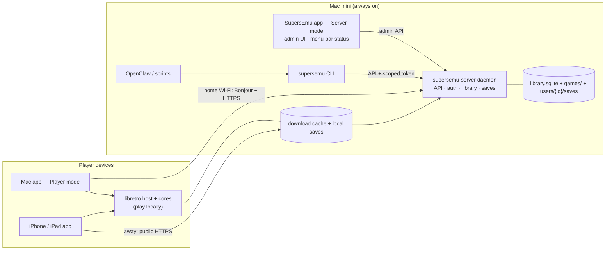

# SupersEmu Server (Mac mini)

Status: **Accepted defaults (public HTTPS, one Mac app with Server/Player modes, invite sign-in).**
[Inference] = design judgement, to be proven in the server spike.

## Requirements (from Chad)
- Mac mini (new, Apple silicon) is the server. Chad controls which games exist and who sees them.
- **Phase 1 is Chad only**, so he can use the server and apps and give feedback first.
- **Phase 2 goal:** fewer than 10 invited users, each with their own account, the games Chad allows,
  and private saves. Optimise for simplicity, not scale.
- Works on the home network and remotely.
- Starts automatically when the Mac mini boots.
- Each user's saves, favourites and history are private to them.
- Easy to drive from CLIs and bots such as OpenClaw.

## Components

Phase 1: only Chad's devices. Phase 2: friends' devices use the same paths, via public HTTPS.

```
Mac mini
 ├─ supersemu-server   launch daemon (headless): HTTP API, SQLite (GRDB), library + user data
 ├─ SupersEmu.app      "Server" admin mode: status, import, review queue, users and game visibility, tokens
 └─ supersemu (CLI)    talks to the API with a token; used by Chad, scripts and OpenClaw

Player devices (Mac, iPhone, iPad)
 └─ SupersEmu.app      sign in, browse permitted games, download/cache, play locally, sync saves
```
- The server is Swift (proposed: Vapor or Hummingbird + GRDB) so library, metadata and save types
  are shared with the client in one Swift package. [Inference]
- One Mac app with Server and Player modes rather than two apps. The daemon ships inside the app
  bundle in `Contents/Library/LaunchDaemons` and is registered with
  `SMAppService.daemon(plistName:)` [Verified: Apple ServiceManagement docs], so it starts at
  boot and runs with no one logged in. [Inference: needs an admin approval once in System Settings, to
  be confirmed on macOS 15+.]

## Data on the server
```
/Library/Application Support/SupersEmu Server/
 ├─ library.sqlite          games, files, hashes, metadata, artwork refs, disc groups, visibility
 ├─ games/<sha256>/…        imported game files (content-addressed, originals never modified)
 ├─ artwork/…
 ├─ metadata/               pinned libretro-database DATs (docs/specs/metadata-and-artwork.md)
 └─ users/<user-id>/
     ├─ saves/<game>/…      native saves, auto states, manual states (immutable, content-hashed)
     └─ profile.json        favourites, history, per-user settings
```
- Import sources: a watched `Incoming` folder on the Mac mini, drag-drop in the admin UI, and
  `supersemu library import <path>`. The pipeline in `import-and-library.md` now runs on the server.
  Server-side paths must resolve (after symlinks) inside `Incoming` or a `supersemu-server run --import-root`
  folder, and never inside the data folder, the library's own folders, the backup destination, hidden folders
  or system folders.
- Every active friend sees every game Chad imports by default. Chad can hide individual games for
  each friend in Server Mode; hiding a game never deletes that friend's saves. New imports are
  shared automatically. Admins always see every game.
- The legacy `/v1/admin/permissions` API remains available for compatibility and auditing, but its
  grants no longer control player visibility.

## Accounts and sign-in
Phase 1: Chad's account is created at server setup (admin). He pairs his own devices by scanning a QR
code from Server mode, which issues a device token. Steps 1–4 below are the Phase 2 invite flow,
built on the same pairing code.

1. Chad creates an invite (admin UI or `supersemu users invite <name>`). The invite is a one-time
   link/QR code containing the server's LAN name, public URL and server certificate fingerprint.
2. The friend opens it in SupersEmu, picks a display name, and the server issues a **per-device
   token** stored in the device Keychain. No password and no Google/Apple account needed.
3. Adding another device: scan a QR from an already signed-in device, or Chad issues a new invite.
4. Chad can revoke a device or a whole user. Revoked tokens stop working immediately.
- Roles: `admin` (Chad), `player`. Bot tokens are separate and scoped (below).
- [Open] Optional "Sign in with Apple" later instead of invite-only. Not needed for <10 users.

## Network access
| Where | How the app reaches the server |
|---|---|
| Home Wi-Fi | Bonjour discovery (`_supersemu._tcp`), direct HTTPS on the LAN |
| Away | Public HTTPS at `games.supersemu.com`, maintained by Cloudflare DDNS |

- Caddy terminates public HTTPS and proxies to a second HTTP listener bound only to loopback. That
  router serves player, pairing and health routes only; admin endpoints remain private, API tokens
  are rejected, and device-token player access remains permission-checked. See `docs/SETUP_MAC_MINI.md`.
- TLS: the server presents its own certificate and the app pins its identity fingerprint from the
  invite on LAN. For the public hostname, the client validates Caddy's renewed certificate with
  system WebPKI trust and still pairs against the server identity pin.
  [Inference] iOS needs the Local Network permission prompt for Bonjour
  (`NSLocalNetworkUsageDescription`, `NSBonjourServices`).

## API (v1, JSON over HTTPS)
```
POST /v1/pair                       invite code -> device token
GET  /v1/library                    games this user may see (+ ETag for cheap refresh)
GET  /v1/games/{id}                 metadata, discs, artwork
GET  /v1/games/{id}/files/{file}    download (HTTP Range for resume)
GET  /v1/saves/{game}               this user's save heads + history
PUT  /v1/saves/{game}/{kind}?slot&parent&core&coreVersion  upload immutable revision (stale parent = branch)
GET  /v1/saves/{game}/revisions/{rev}  download one revision
GET  /v1/events                     server-sent events: library.updated, save.synced, …
admin: /v1/admin/users, /invites, /permissions, /library/import, /library/publish, /tokens
       /v1/admin/library/upload?batch=&path= (stream one file), /library/upload/{batch}/finish (move batch into Incoming, scan)
       /v1/admin/library/issues (Review Needed), /issues/{id}/system (pick console), DELETE /issues/{id}
       /v1/admin/metadata/rematch (queue metadata matching again)
       /v1/admin/storage, /storage/move (Move Library)
```
- Saves: same model as `save-and-resume.md`. The server stores immutable revisions per user. An upload
  whose parent isn't the current head becomes a branch, never an overwrite. "Synced" shows only
  after the server confirms.
- Downloads: whole files to the device cache with resumable Range requests. PS1 discs are large, so
  the cache UI shows sizes and lets users remove downloaded games.

## Backups (`SupersEmuServerCore/Backups`)
- `BackupManager` writes `SupersEmu-<yyyyMMdd-HHmmss>/` into the destination (default
  `<data dir>/Backups`, typically an external drive): `library.sqlite` via SQLite's online backup API
  (consistent while serving, switched to a single-file journal), `users/` (save revisions), `artwork/`,
  `tls/` + `admin.token` (paired devices keep their pin after a restore), other top-level settings
  `*.json`, and `manifest.json` with size + SHA-256 for every file. `games/` and `bios/` only with
  `includeROMs`; the BIOS index is always in the database. Written to a `.partial` folder and renamed
  only after verification.
- Verification (after every backup, before every restore, `POST …/:id/verify`): every file matches the
  manifest (none missing, extra or changed) and `PRAGMA integrity_check` is `ok`.
- Config and the last result live in `<data dir>/backups.json` (not backed up): destination, keep N
  (default 7), includeROMs, daily hour (default 03:00). The daemon runs today's slot if it hasn't
  been attempted (catch-up after sleep/power-off), then daily. A destination under `/Volumes/<name>`
  needs that volume mounted; an unplugged drive is a failed backup, never a write to the boot disk.
  After a successful backup older ones beyond N are deleted.
- Restore: the route verifies, answers 202, then `ServerLauncher.run` stops serving, closes the
  database, moves what it replaces to `<data dir>/.pre-restore/`, copies the backup in (ROMs/BIOS
  files only when the backup has them), reopens (running migrations) and serves again. Any failure
  puts the previous data back.
- Admin API (admin + `users:admin`, audited): `GET /v1/admin/backups` (config, last result, next run,
  backups), `POST /v1/admin/backups` (`{includeROMs?}`), `GET|PUT /v1/admin/backups/config`,
  `POST /v1/admin/backups/:id/verify`, `POST /v1/admin/backups/:id/restore`.

## Offline and unreachable (`ServerSession`, `ConnectionBanner`)
- `ServerSession.connection` is `connected(.home | .internet)` (Internet means the
  profile's configured public URL), `connecting`, `unreachable`, `certificateMismatch` (the
  pinning delegate refused the certificate) or `signedOut(.notPaired | .revoked)` (401). The state
  machine is `SupersEmuKit.ConnectionMonitor`.
- Unreachable and certificate mismatch retry with backoff (2, 4, 8 … 60 s; 300 s cap for a
  mismatch). A network change (`NWPathMonitor`: Wi-Fi or leaving home) resets the
  backoff and retries at once, as do foregrounding and the banner's Retry.
- `ConnectionBanner` above the library: "Can't reach <server>. Check that it's on and connected to
  the internet.", a certificate or signed-out message and a
  short "Back online" after recovering. Offline, downloaded games play; games that aren't downloaded
  are unavailable (counted in the banner, "Unavailable offline" on the game page, no download
  attempt).

## CLI and bots (OpenClaw)
```
supersemu server status
supersemu library scan | import <path> | publish <game> --to <user|group>
supersemu users list | invite <name> | revoke <user>
supersemu tokens create --scope library:read,library:write --name openclaw
supersemu backup create | list [--verify] | restore <id> --yes | config [--destination …] [--keep N]
```
- OpenClaw [Verified: openclaw.ai, github.com/openclaw/openclaw] is a self-hosted agent gateway with
  a CLI and a skills/plugin system. We ship a SupersEmu skill that calls the `supersemu` CLI, so a
  message like "add the games in Downloads and give them to Alex" works through the API.
- Bot tokens are scoped (`library:read`, `library:write`, `users:admin`, `saves:read`), every call is
  audit-logged, writes are idempotent, and no scope can delete game files or overwrite a user's save.
- Webhooks (Phase 2): `game.imported`, `library.updated`, `user.invited`, `save.synced`,
  `server.health_changed`.

## Phases
| Phase | Who | Server scope |
|---|---|---|
| **1** | Chad only | Daemon at boot, Server mode admin UI, import/organise on the server, Chad's admin account, pair his devices by QR, library + downloads/cache, save sync across his devices, LAN + public HTTPS, CLI + scoped tokens (OpenClaw) |
| **2 goal** | Chad + <10 invited friends | Invites, player role, per-user hidden-game lists, private per-user saves and history, public HTTPS access, revoke users/devices, users screen in admin, webhooks, server backups, "server offline" UX |

Built in Phase 1 so Phase 2 is additive, not a rewrite:
- A `users` table from day one, with Chad as the only admin. Saves and profiles live under `users/<id>/`.
- Every API request resolves token → device → user, then applies role and scope checks. Admins see
  every game; friends see every game except those hidden for them.
- The library API only returns games visible to the requesting user (all games for admins).
- Device pairing is the same code the Phase 2 invite uses.

## Legal note (not legal advice)
The server only ever holds files Chad imports. Sharing copies of games with friends is Chad's
responsibility. SupersEmu ships no games or BIOS files.

## Spike at the start of M1 (needs the new Mac mini)
- Daemon starts at boot with no user logged in. API reachable on LAN and over public HTTPS from an iPhone on cellular.
- Pair an iPhone from a pairing QR. Revoke it and confirm the next request fails.
- Download a large file over public HTTPS with a resume after interruption.

## Library management (M3, Server Mode)
- **Uploads** (`admin` + `library:write`): each file streams to `Incoming/.uploads/<batch>/<path>` through a hidden
  partial file; `finish` moves the batch to `Incoming/Uploads/<batch>` and scans Incoming. Paths must be relative and
  made of visible names (no `..`, hidden components, `:` or `\`, at most 16 levels); batch ids are 1-64 letters, digits
  or dashes. Limits: 4 GB per file and 512 MB free space left on the library volume (413 / 507). Settled uploads are
  deleted (they're copies) instead of being kept in `Imported/`. Unfinished batches are dropped after a day.
- **Review Needed**: each scan records what it left in Incoming (`import_issues`) with the reason. `issues` merges
  those with the review queue. Picking a console is offered only for a single cartridge ROM that's unknown or
  ambiguous; discs and unsupported formats never get one. Delete removes the queued copy and the Incoming file.
- **Storage**: games, BIOS, artwork, Incoming and Imported live in the library root, which defaults to the data
  folder; `storage.json` in the data folder points it elsewhere. The database, TLS identity, tokens and saves always
  stay in the data folder. Move Library copies, verifies size and SHA-256 of every file, rewrites `storage.json`,
  then removes the old copy; on any failure the partial copy is removed and nothing switches. If the library's drive
  is missing at boot the server still starts, creates nothing in its place, reports `available: false`, and refuses
  imports/uploads with 503 until the drive is back.
